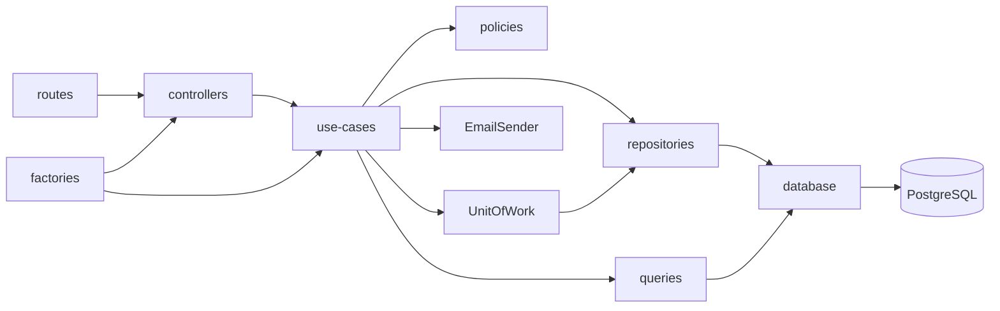
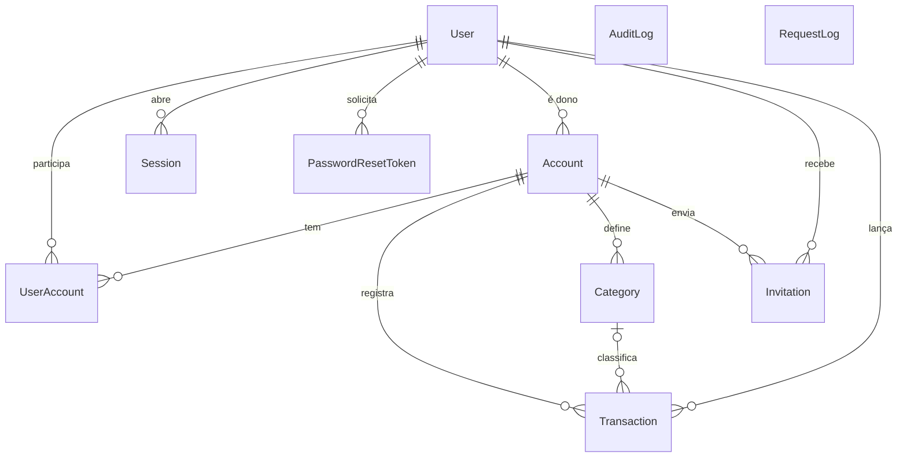
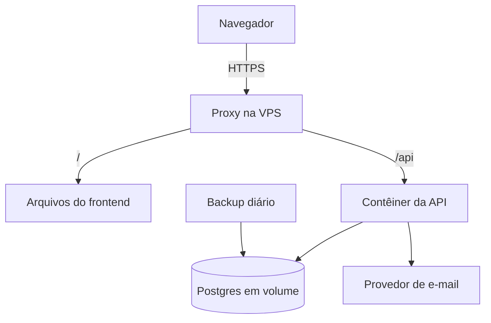

# Architecture Spine: My Finances

## Design Paradigm

Monólito em camadas, estilo Clean Architecture, com dependências apontando só para dentro. Cada camada mapeia para uma pasta de `src/`; `policies/` e `gateways/` são novas.

| Camada | Pasta | Responsabilidade |
| --- | --- | --- |
| Rotas | `routes/` | Caminho HTTP e middlewares |
| Controllers | `controllers/` | Traduz HTTP para o use case e `Either` para status |
| Use cases | `use-cases/` | Valida (Zod), autoriza, aplica regras, abre o Unit of Work |
| Repositórios | `repositories/` | Escrita e leitura de entidade |
| Queries | `queries/` | Leituras compostas e agregações |
| Entidades | `entities/` | Dados de domínio e `toOutput`, chamado pelos mappers |
| Políticas | `policies/` | Regras de acesso |
| Gateways | `gateways/` | Portas para serviços externos |
| Banco | `database/` | Único dono do cliente Prisma, da extensão e do Unit of Work |
| Composição | `factories/` | Injeção de dependências |



## Invariants & Rules

### AD-1: Camadas e contrato do use case [ADOPTED]

- **Binds:** all
- **Prevents:** regra de negócio em controller e formatos de falha divergentes.
- **Rule:** O fluxo é `routes → controllers → use-cases → repositories/queries`, com dependências montadas em `factories/`. Todo use case estende `AbstractUseCase`, valida a entrada com Zod e retorna `Either`. Só o `handleError` do controller mapeia erro para status HTTP.

### AD-2: Autorização no use case

- **Binds:** FR-3 a FR-14, FR-16, FR-19, FR-20, FR-24, NFR-1
- **Prevents:** regras de acesso diferentes por endpoint, `isAdmin` forjado e acesso que sobrevive à remoção do Membro.
- **Rule:** O contrato é `useCase.run(input, actor)`, com `actor { userId, isAdmin }` montado só pelo middleware; `actor` nunca entra em `input`. O middleware lê `User.isAdmin` do banco junto com a Sessão e só autentica. Controllers montam `input` por campos explícitos, com parâmetros de rota por último. O Zod valida primeiro, e a política de `src/policies/` é a primeira ação de `execute`. Vínculo, Permissão e Dono são sempre lidos do banco. Não Membro e Conta com `deletedAt` recebem 404; Membro sem a Permissão exigida recebe 403. A política de Membro nunca dá passe ao Admin: `requireAdmin` protege `/api/admin/*`, as únicas leituras que veem outras Contas e linhas com `deletedAt`. Admin que também é Membro usa as rotas normais. Transferências recebem `{ newOwnerId, previousOwnerPermission }`, definidos por quem executa.

### AD-3: Isolamento por Conta nos repositórios

- **Binds:** FR-8, FR-10, FR-17, FR-20, NFR-1
- **Prevents:** vazamento entre Contas como o da issue #25, inclusive por valor de FK.
- **Rule:** Repositórios e queries de dados de Conta (Movimentação, Categoria, Membro, Convite, Balanço) não estendem `BaseRepository`: estendem `AccountScopedRepository`, em que `accountId` é parâmetro obrigatório de toda operação, inclusive `update` e `delete`. Consultas por Usuário são exceções nomeadas, com `userId` obrigatório igual a `actor.userId` ou em use case de Admin: `findAccountsByUser`, `findPendingInvitationsByInvitee`, `findInvitationByIdAndInvitee` e `deleteMembershipsByUser`. `accountId` vem só do caminho e é imutável. A Categoria da Movimentação é garantida por FK composta `(accountId, categoryId) → Category(accountId, id)`.

### AD-4: Dono e Permissão no modelo

- **Binds:** FR-7, FR-9 a FR-13, FR-24
- **Prevents:** Conta sem Dono ou com dois Donos e fontes divergentes de quem manda.
- **Rule:** O Dono é a coluna obrigatória `Account.ownerId`, fonte única. Em Conta sem `deletedAt`, o Dono tem linha em `UserAccount` com `permission = MANAGEMENT`, em `ENTRY | MANAGEMENT`. O mapper de Membro retorna `isOwner`. A transferência altera `ownerId` e as duas Permissões em um único Unit of Work, sob o AD-22.

### AD-5: Sessão em banco e tokens

- **Binds:** FR-1, FR-2, FR-3, FR-5, NFR-5
- **Prevents:** logout ou exclusão que não valem de imediato, uso de um token no lugar do outro e Sessão derrubada por duas abas.
- **Rule:** O login cria uma linha em `Session`. O token de acesso é JWT de 15 minutos com `sub` e `sessionId`, sem dados de permissão. O token de renovação é aleatório e opaco, guardado só como hash, e aceito somente em `POST /api/refresh`. A Sessão guarda o hash atual, o anterior e `rotatedAt`. O hash anterior, em até 30 segundos da rotação, recebe novo token de acesso sem nova rotação; depois disso é reuso e revoga a Sessão. A troca é compare-and-swap: `update` filtrado pelo hash atual, e `P2025` nesse ponto vira 401. O middleware exige Sessão ativa e Usuário sem `deletedAt`. Cada renovação estende a Sessão por 7 dias. Logout revoga a Sessão atual; exclusão, troca e redefinição de senha revogam todas as Sessões do Usuário. Credenciais inválidas têm a mesma resposta, e o login compara hash mesmo para e-mail inexistente.

### AD-6: Transporte dos tokens no navegador

- **Binds:** FR-1, frontend
- **Prevents:** roubo de sessão por XSS e clientes tratando o token de formas diferentes.
- **Rule:** O token de renovação trafega só em cookie `HttpOnly; Secure; SameSite=Strict; Path=/api/refresh; Max-Age=604800`, renovado a cada rotação, e essa rota exige o header `X-Requested-With`. O token de acesso fica só em memória e vai no header `Authorization: Bearer`. Frontend e API são servidos na mesma origem, pelo proxy em produção e pelo proxy do Vite em desenvolvimento, sem CORS com credenciais. Nada de token em `localStorage`.

### AD-7: Dinheiro em centavos

- **Binds:** FR-7, FR-15, FR-21 a FR-23, NFR-3
- **Prevents:** erro de ponto flutuante e APIs com unidades diferentes.
- **Rule:** Valores são inteiros em centavos no banco, no código e na API; só a interface converte para exibir. `Transaction.amount` é `Int` de 1 a 2.147.483.647, sempre positivo, e `type` é `INCOME | EXPENSE`. `Account.initialBalance` é `Int`, padrão 0, e pode ser negativo. Somas em SQL usam `bigint` e são convertidas para `number` na query.

### AD-8: Datas e fuso

- **Binds:** FR-15, FR-17, FR-21, FR-22, NFR-8
- **Prevents:** Movimentação caindo no dia ou mês errado e cálculos de mês divergentes.
- **Rule:** `occurredAt` é `timestamptz`, recebido em ISO 8601 ou `YYYY-MM-DD` e retornado em ISO 8601 UTC. Entrada só com data vira o primeiro instante daquele dia em `America/Sao_Paulo`; se omitida, o servidor usa hoje nesse fuso. Mês é `YYYY-MM`, com duas implementações testadas uma contra a outra nas viradas: `src/util/month.ts`, com intervalo `[início, próximo início)` e `@date-fns/tz`, e, em SQL, `to_char("occurredAt" AT TIME ZONE 'America/Sao_Paulo', 'YYYY-MM')`. Filtros `from` e `to` são `YYYY-MM-DD`, inclusivos nesse calendário, traduzidos para intervalo semiaberto. Data posterior a hoje nesse fuso retorna 400. O frontend sempre formata nesse fuso, sem cortar string ISO, e obtém "hoje" só por `Intl` com esse fuso, para preencher a data no formulário.

### AD-9: Exclusão lógica única

- **Binds:** FR-1, FR-5, FR-6, FR-11, FR-12, FR-14
- **Prevents:** estados paralelos de "desativado" e "excluído" e leituras que os tratam de formas diferentes.
- **Rule:** `User` e `Account` usam só `deletedAt`; não existe desativação nem motivo da exclusão. Usuário com `deletedAt` não faz login. Saída, remoção e exclusão de Usuário apagam fisicamente a linha de `UserAccount`, e a autoria permanece. O e-mail de Usuário excluído continua reservado. Excluir um Usuário que é Dono de Conta sem `deletedAt` e com outros Membros é rejeitado até a transferência. Se ele for o único Membro, a Conta recebe `deletedAt` no mesmo Unit of Work. Conta com `deletedAt` não aceita transferência. A remoção de Movimentação é física, registrada na auditoria. A restauração fica fora da v1.

### AD-10: Toda escrita passa pelo Unit of Work

- **Binds:** FR-7, FR-13, FR-18, NFR-4
- **Prevents:** escrita parcial, auditoria fora da transação e autoria perdida.
- **Rule:** Use cases escrevem somente em `uow.run(actor, repos => ...)`, com `actor` obrigatório, usando a constante `SYSTEM` apenas em login, renovação e recuperação de senha. O `uow.run` é o único que grava o actor no `AsyncLocalStorage`, cria os repositórios com o cliente transacional por `createRepositories(db)` e executa o callback com `await`. Se o callback retornar `Wrong`, faz rollback e devolve o `Wrong`. Timeout de 30 s e `maxWait` de 5 s. Operações no callback são sequenciais. A extensão rejeita escrita sem actor no contexto. Repositórios e queries recebem o tipo `DbClient`, exportado de `src/database/`, que aceita o cliente estendido e o de transação; a paginação faz as duas consultas sem `$transaction` aninhado. Queries rodam depois do commit. Testes de use case usam o `FakeUnitOfWork` padrão. Hash de senha fica fora da transação, e e-mail sai só depois do commit.

### AD-11: Operações proibidas no cliente da aplicação

- **Binds:** all, FR-18
- **Prevents:** escrita que escapa da auditoria.
- **Rule:** A extensão lança `ForbiddenOperationError` em `createMany`, `createManyAndReturn`, `updateMany`, `updateManyAndReturn`, `deleteMany`, `$executeRaw`, `$executeRawUnsafe`, escrita aninhada de relação e `$queryRaw` ou `$queryRawUnsafe` que não seja leitura. A checagem de SQL é por palavra-chave: evita erro, não é fronteira de segurança. Escritas usam chave estrangeira escalar, uma linha por vez, inclusive quando afetam várias linhas. Chaves estrangeiras de dados de negócio são `Restrict`: efeitos como "excluir Categoria limpa as Movimentações" são feitos linha a linha no use case. O valor `PrismaClient` só é importado em `src/database/` e em testes, garantido por `no-restricted-imports`; tipos de modelo seguem liberados. Seeds e populates usam o cliente puro e não geram auditoria.

### AD-12: Auditoria de escrita

- **Binds:** FR-18, NFR-8
- **Prevents:** histórico incompleto e segredo gravado em log.
- **Rule:** A extensão grava em `AuditLog`, na mesma transação, cada `create`, `update`, `upsert` e `delete`: instante, autor, modelo, id do registro, operação, estado anterior e posterior. `actorId` é texto sem chave estrangeira, com o id do Usuário ou `system`. Toda coluna de segredo termina em `Hash`, e a extensão mascara `password` e `*Hash`. `AuditLog` e `RequestLog` não são auditados e são mantidos sem exclusão na v1. Um teste e2e confirma que escrever Movimentação grava o Usuário autenticado como autor.

### AD-13: Registro de requisições

- **Binds:** auditoria ampliada, NFR-2
- **Prevents:** senha, token ou dado financeiro em log e perda de requisição por falha do log.
- **Rule:** Um middleware grava em `RequestLog`, ao terminar cada resposta: método, padrão da rota com segmentos UUID trocados por `:id` (ou `UNMATCHED`), status, duração e autor. Corpo, query string e headers não são gravados, e tokens nunca trafegam no caminho da API. A gravação usa o cliente interno de `src/database/`, fora do Unit of Work, e sua falha nunca altera a resposta.

### AD-14: Balanço calculado na leitura

- **Binds:** FR-21 a FR-23, FR-14, NFR-3, NFR-8
- **Prevents:** saldo salvo divergindo das Movimentações.
- **Rule:** O Balanço é calculado por agregação SQL em `queries/`, sem tabela de saldos, com índice em `(accountId, occurredAt)`. `GET /account/:accountId/balance` retorna `{ data: MonthlyBalanceSummary[] }`, do mês atual até o da primeira Movimentação, sem paginação; Conta sem Movimentação retorna `{ data: [] }`. `GET .../balance/:month` retorna `MonthlyBalance`, ou 404 fora do intervalo. `MonthlyBalanceSummary = { month, totalIncome, totalExpense, result, accumulatedBalance }`. `MonthlyBalance` acrescenta `categories: [{ categoryId, categoryName, income, expense }]`, com um único item `categoryId: null` para "Sem categoria". As Movimentações do mês vêm de `GET .../transaction?from=&to=`, e o cliente percorre todas as páginas.

### AD-15: E-mail por porta

- **Binds:** FR-2, FR-9
- **Prevents:** provedor acoplado às regras, falha de e-mail desfazendo dados e revelação de e-mails cadastrados.
- **Rule:** Use cases dependem de `EmailSender.send({ to, subject, text, html })`, injetada pelas factories, com implementação falsa em dev e teste. Links usam `APP_BASE_URL`. No Convite, a resposta é 201 com `{ emailDelivered: boolean }`, e o Convite permanece salvo. Na recuperação, a resposta é sempre 202 com corpo fixo, o envio ocorre sem `await` e a falha só vai para o log.

### AD-16: Validade por comparação de data

- **Binds:** FR-2, FR-1
- **Prevents:** divergência entre um job de expiração e o que cada endpoint considera válido.
- **Rule:** Sessão, Convite e link de recuperação têm `expiresAt`, comparado no uso, sem job de limpeza. Só o link de recuperação usa token: guardado como hash, enviado à API no corpo, válido por uma hora e consumido por compare-and-swap (uso repetido retorna 400).

### AD-17: Erros previsíveis

- **Binds:** NFR-4
- **Prevents:** regra de negócio retornando 500 e formatos de erro diferentes.
- **Rule:** Toda falha de regra é uma classe em `src/errors/` retornada como `wrong(...)` e mapeada em `getErrorMap`, que ganha 403 e 429. O `catch` de `AbstractUseCase.run` é o único tradutor de erros do Prisma: `P2002` e `P2003` viram 409, `P2025` vira 404, `P2028` e `P2034` viram 503; o restante vira `UnknownError`. O corpo de erro é o atual `{ code, error, slug }`, com `error: { message, errors }` em validação, inclusive no middleware.

### AD-18: Ambientes e entrega

- **Binds:** NFR-6
- **Prevents:** imagem de desenvolvimento em produção, deploy não reproduzível e banco errado apagado por teste.
- **Rule:** Há dois ambientes, desenvolvimento e produção. Em desenvolvimento, a API roda no host, e o Compose sobe só o banco em `127.0.0.1`, criando também o banco de teste. `.nvmrc` e `packageManager` fixam as versões. Com `NODE_ENV=test`, a API usa `DATABASE_URL_TEST`, e a limpeza recusa banco cujo nome não termine em `_test`. O `Dockerfile` é multi-stage, exclusivo de produção, com usuário sem root, e tem um alvo `migrate` com a CLI do Prisma. O CI usa pnpm e roda lint, `tsc`, testes e build; na `main`, publica a imagem marcada pelo commit. Segredos ficam só no ambiente do servidor, a aplicação recusa o `JWT_SECRET` de exemplo, e o `.env.example` traz placeholder.

### AD-19: Limite de login

- **Binds:** NFR-6
- **Prevents:** força bruta e contagens diferentes por instância.
- **Rule:** `POST /api/login` aceita 5 tentativas a cada 15 minutos por e-mail normalizado, com `express-rate-limit` em memória e resposta 429. Vale porque a API roda em uma única instância; ao escalar, o contador vai para armazenamento compartilhado.

### AD-20: Testes de ponta a ponta

- **Binds:** NFR-8
- **Prevents:** isolamento e permissões cobertos só com repositórios falsos.
- **Rule:** `app.ts` exporta o Express sem escutar porta, e `server.ts` só inicia. Testes e2e usam supertest contra PostgreSQL real e cobrem cada item do NFR-8.

### AD-21: Ciclo de vida do Convite

- **Binds:** FR-9, FR-10
- **Prevents:** Convite vencido bloqueando novo Convite e aceite em Conta excluída.
- **Rule:** `Invitation` tem `inviteeUserId` e `status` em `PENDING | ACCEPTED | DECLINED | EXPIRED | CANCELLED`, alterado só em `use-cases/invitation`. Um índice único parcial, por SQL manual, cobre `(accountId, inviteeUserId) WHERE status = 'PENDING'`. Enviar, no mesmo Unit of Work, marca como `EXPIRED` o pendente vencido do par antes de criar o novo. O reenvio é `POST /account/:accountId/invitation/:id/resend` e não altera `expiresAt`. Aceitar e recusar são `POST /invitation/:id/{accept,decline}`, autorizados por `inviteeUserId = actor.userId`, senão 404. Aceitar exige pendente não vencido, Conta sem `deletedAt` e convidado ainda não Membro. Excluir Conta ou Usuário marca os pendentes como `CANCELLED`.

### AD-22: Transições de Membro serializadas por Conta

- **Binds:** FR-5, FR-10 a FR-14, FR-24
- **Prevents:** Dono sem vínculo, Conta excluída com Membro novo e transferências que se sobrescrevem.
- **Rule:** Transferência, remoção, saída, alteração de Permissão, aceite de Convite e exclusão de Conta ou Usuário rodam com `uow.run(actor, fn, { lockAccounts })`. O Unit of Work executa `SELECT pg_advisory_xact_lock(hashtext(id))::text`, em ordem crescente de id, antes do callback, e o callback relê a política e as pré-condições.

### AD-23: E-mail canônico e senha

- **Binds:** FR-1 a FR-4, FR-9, NFR-6
- **Prevents:** duplicidade por maiúsculas e políticas de senha divergentes.
- **Rule:** Todo e-mail passa por um único `zEmail`, com `trim` e minúsculas, formato único gravado, buscado e usado no limite de login. Toda senha passa por um único `zPassword`, que aceita qualquer símbolo (D-20). `cpf` sai do modelo, da API e dos seeds.

### AD-24: Produção e operação

- **Binds:** NFR-6, NFR-7
- **Prevents:** perda de dados sem saída, publicação sem Admin e comportamento diferente atrás do proxy.
- **Rule:** Produção é uma VPS com Docker Compose: proxy com HTTPS, frontend estático, uma instância da API e Postgres em volume, sem porta pública, com `restart: unless-stopped`. O proxy serve `/` e `/api` na mesma origem, e a API usa `trust proxy = 1`, `helmet` e CORS fechado. O deploy baixa a imagem do commit, roda o alvo `migrate` e sobe a API; migrations são compatíveis com a versão anterior, e o rollback sobe a imagem anterior. O `pg_dump` diário é copiado para fora da VPS, e uma restauração testada é condição para o uso real. O primeiro Admin vem de `pnpm admin:create`, idempotente e não destrutivo, com senha por variável de ambiente; seeds de desenvolvimento não rodam em produção nem dependem de `test/`. Logs vão para stdout, e `/health` verifica o banco.

### AD-25: Migração do modelo

- **Binds:** NFR-2, NFR-3, FR-15
- **Prevents:** regras de preenchimento inventadas em cada migration.
- **Rule:** Não há dados de produção a preservar. O histórico atual de migrations é apagado e o schema recomeça do zero. Cada história adiciona a própria migration, com as tabelas de que precisa, sem preenchimento retroativo.

## Consistency Conventions

| Concern | Convention |
| --- | --- |
| Idioma | Código em inglês, mensagens ao usuário em português |
| Termos | Usuário `User`, Conta `Account`, Membro `UserAccount`, Dono `owner`, Movimentação `Transaction`, Entrada `INCOME`, Saída `EXPENSE`, Categoria `Category`, Convite `Invitation`, Balanço `MonthlyBalance` |
| Arquivos | `kebab-case.tipo.ts`, por exemplo `create-account.usecase.ts`; IDs UUID |
| Rotas | Prefixo `/api`, recursos no singular: `/login`, `/refresh`, `/logout`, `/me`, `/invitation`, `/password/forgot`, `/password/reset`, `/account`, `/account/:accountId/{transaction,category,member,invitation,balance,transfer}`, `/admin/{user,account}`, `/admin/account/:accountId/transfer`. Criação retorna 201 com `Location` |
| Listas | `{ data, pagination: { page, limit, total, totalPages } }`, com `limit` máximo de 100 e ordenação explícita terminando em `id`; a única exceção é a lista de meses do AD-14. Movimentações: `occurredAt desc, createdAt desc, id desc` |
| Métodos | `PATCH` altera parcialmente: campo ausente não muda, `null` limpa (como `categoryId`). `DELETE` responde 204. `/password/*` é montado antes do middleware de autenticação |
| Categoria | Único `@@unique([accountId, name])`, nome com `trim` e comparação exata |
| Filtros | Declarados no schema Zod de cada use case; `autoParseFilters` é removido |
| Saída | Sempre por mapper; entidade e linha do Prisma nunca vão para a resposta, e hash nunca sai da API |
| Frontend | Vue 3 com `<script setup>`, Pinia, Vue Router com rotas manuais e guards, axios com interceptors e renovação única compartilhada, Zod nos formulários, Tailwind e componentes `Base*` próprios. Pastas `pages`, `components`, `composables`, `services`, `stores` e `plugins`, com serviço e store por domínio; publicado por `my-finances-frontend` |

## Stack

Versões conferidas no registro npm e no `pnpm audit` em 2026-11-08; Prisma, Express, Zod, jsonwebtoken e uuid sobem para versões sem as vulnerabilidades apontadas.

| Name | Version |
| --- | --- |
| Node.js | 24 |
| pnpm | 10 |
| TypeScript | 5.9.3 |
| Express | 5.3.0 |
| Zod | 4.6.7 |
| Prisma | 6.19.3 |
| PostgreSQL | 16 |
| Jest | 30.2.0 |
| jsonwebtoken | 9.0.3 |
| bcryptjs | 3.0.3 |
| express-rate-limit | 8.7.3 |
| supertest | 7.3.2 |
| cookie-parser | 1.4.7 |
| helmet | 8.3.0 |
| date-fns | 4.4.0 |
| @date-fns/tz | 1.5.0 |
| uuid | 11.1.1 |
| tsc-alias | 1.9.10 |
| Vue | 3.5.45 |
| Vite | 8.3.6 |
| Vue Router | 5.4.0 |
| Pinia | 4.1.0 |
| axios | 1.21.0 |
| Tailwind CSS | 4.3.5 |

## Structural Seed





```text
src/
  policies/    # regras de acesso por Conta (novo)
  database/    # cliente Prisma, extensão, Unit of Work, contexto
  gateways/    # EmailSender e implementações (novo)
  app.ts       # Express sem listen (novo)
  server.ts    # só inicia
```

## Capability → Architecture Map

| Capability / Area | Lives in | Governed by |
| --- | --- | --- |
| FR-1 a FR-3 Acesso | `use-cases/session`, `use-cases/user`, `Session` | AD-2, AD-5, AD-6, AD-15, AD-16, AD-19, AD-23 |
| FR-4 a FR-6 Administração | `use-cases/admin`, rotas `/admin` | AD-2, AD-5, AD-9, AD-22, AD-23 |
| FR-7 a FR-14, FR-24 Contas e Membros | `use-cases/account`, `use-cases/member`, `use-cases/invitation` | AD-2, AD-3, AD-4, AD-9, AD-10, AD-21, AD-22 |
| FR-15 a FR-17 Movimentações | `use-cases/transaction` | AD-2, AD-3, AD-7, AD-8 |
| FR-18 Autoria | `Transaction.createdById`, extensão | AD-10, AD-11, AD-12 |
| FR-19, FR-20 Categorias | `use-cases/category` | AD-2, AD-3, AD-11 |
| FR-21 a FR-23 Balanço | `queries/balance` | AD-2, AD-3, AD-7, AD-8, AD-14 |
| NFR-1, NFR-2 | políticas, repositórios, mappers | AD-2, AD-3, AD-13, AD-23 |
| NFR-3 | banco, queries | AD-7 |
| NFR-4 | `core/`, `errors/` | AD-1, AD-17 |
| NFR-5 | `Session`, middleware | AD-5 |
| NFR-6 | Docker, CI, VPS | AD-18, AD-19, AD-24 |
| NFR-7 | Frontend web | AD-6, AD-24, Convenções |
| NFR-8 | `test/e2e` | AD-20 |

## Deferred

| Item | Por que pode esperar | Revisitar quando |
| --- | --- | --- |
| Provedor de e-mail, SPF e DKIM | Isolados pela porta do AD-15 | Na preparação para produção |
| Retenção de `RequestLog`, `AuditLog` e `Session` | Volume baixo no início | Antes do uso real ou se as tabelas crescerem |
| Fila de e-mail com novas tentativas | Evolução de estudo | Quando o envio direto for insuficiente ou por interesse de estudo |
| Migração de Prisma e TypeScript para novas versões maiores | A extensão foi testada em Prisma 6.19.0 | Depois da v1, repetindo os testes da extensão |
| Provedor e tamanho da VPS, software do proxy e destino do backup | O AD-24 fixa o que afeta o código | Na preparação para produção |
| Monitoramento e alertas externos | Dois usuários; logs em stdout bastam | Depois do uso real |
| Documentação da API (issue #19) | Desejável, não bloqueia a v1 | Ao estabilizar as rotas |
| Integração bancária | Fora do escopo; `occurredAt` já aceita hora | Depois da v1 |
